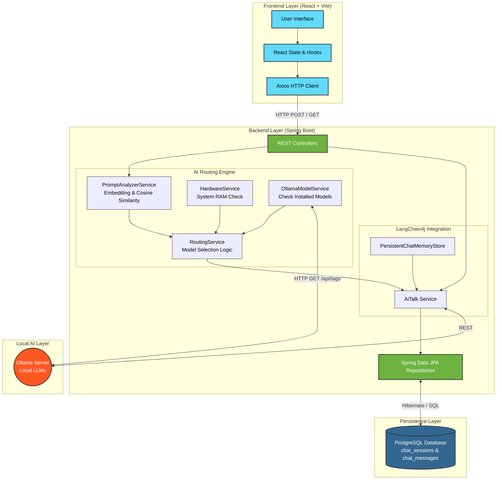
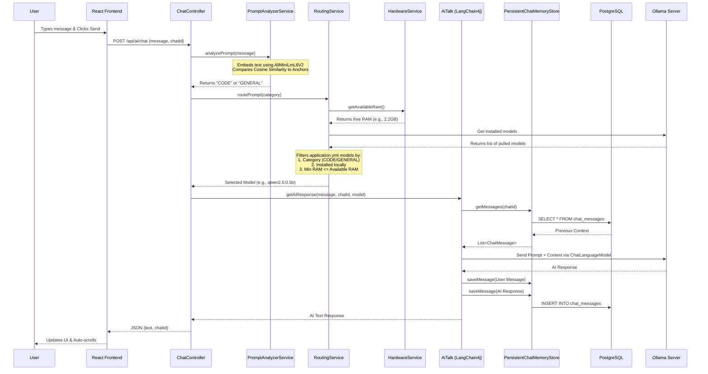

# Nexus AI - Complete Project Details

Nexus AI is a full-stack, stateful, and intelligent chat application. It integrates a React frontend with a highly dynamic Spring Boot backend that features an autonomous AI routing engine. This engine dynamically selects the most appropriate local Large Language Model (LLM) based on the user's prompt classification and the system's real-time hardware constraints (available RAM).

---

## 1. System Architecture

The architecture is designed to be fully local, private, and highly scalable.



---

## 2. Process Flow: Chat Request Lifecycle

This flow demonstrates the intelligent routing and memory persistence that occurs the moment a user sends a message.



---

## 3. Frontend Details

**Tech Stack:** React 19, Vite, Material-UI (MUI), Axios, ReactMarkdown.

### Core Features
- **Dynamic Layout:** Uses MUI `Grid` to split the screen into a 3-column sidebar (chat history) and a 9-column main chat interface.
- **State Management:** Fully functional components using React hooks (`useState` for storing messages and sessions, `useEffect` for data fetching on load).
- **Auto-Scrolling:** Implements `useRef` pointing to an invisible `<div>` at the bottom of the chat. A `useEffect` triggers `.scrollIntoView({behavior: "smooth"})` every time the messages array updates.
- **Markdown Rendering:** AI responses are processed through `<ReactMarkdown>`, allowing proper rendering of bold text, headers, and code blocks generated by the LLM.
- **API Communication:** Uses `axios` to seamlessly communicate with the Spring Boot backend via JSON payloads.

---

## 4. Backend Details

**Tech Stack:** Java 25, Spring Boot 4.0, LangChain4j, PostgreSQL, Hibernate/JPA.

### Core Modules

1. **PromptAnalyzerService (Semantic Classification)**
   - Initializes a local in-memory embedding model (`AllMiniLmL6V2EmbeddingModel`).
   - Pre-computes anchor embeddings for `CODE` topics and `GENERAL` topics on startup.
   - When a prompt arrives, it converts the text into a vector embedding and calculates the **Cosine Similarity** against the anchors to classify the user's intent.

2. **RoutingService (Dynamic Fallback)**
   - Reads configured models from `application.yml` (`nexus.models.code` and `nexus.models.general`).
   - Uses `OperatingSystemMXBean` to check real-time available system RAM.
   - Checks the local Ollama instance for installed models.
   - Filters the configuration list to find the smartest (highest RAM requirement) model that fits into the current free memory and matches the prompt's semantic category.

3. **AiTalk & PersistentChatMemoryStore (Context Management)**
   - Integrates with LangChain4j `AiServices`.
   - Uses a custom implementation of `ChatMemoryStore` to intercept LangChain4j's memory system.
   - Automatically saves and retrieves `SystemMessage`, `UserMessage`, and `AiMessage` to/from PostgreSQL, ensuring the LLM remembers previous turns in the conversation.

### API Routes

| HTTP Method | Endpoint | Description | Payload / Params |
|-------------|----------|-------------|------------------|
| **POST** | `/api/ai/chat` | Send a user message to the AI and get a response. | JSON: `{ "message": "string", "chatId": "uuid-string (optional)" }` |
| **GET** | `/api/chats` | Retrieve all historical chat sessions for the sidebar. | None |
| **GET** | `/api/chats/{sessionId}/messages`| Retrieve the full message history for a specific chat. | Path Variable: `sessionId` |

---

## 5. Database Schema (PostgreSQL)

The persistence layer relies on two main tables managed automatically by Hibernate (`ddl-auto: update`):

**`chat_sessions`**
- `id` (VARCHAR 255) - Primary Key (UUID)
- `title` (VARCHAR 255) - Generated summary of the chat
- `created_at` (TIMESTAMP) - Timestamp of creation

**`chat_messages`**
- `id` (VARCHAR 255) - Primary Key (UUID)
- `session_id` (VARCHAR 255) - Foreign Key to `chat_sessions`
- `sender` (VARCHAR 255) - 'USER' or 'AI'
- `text` (TEXT) - The actual content of the message
- `timestamp` (TIMESTAMP) - Time the message was sent

---

## 6. Configuration Example (`application.yml`)
The engine is configured via custom properties that define the RAM boundaries for the routing engine:

```yaml
nexus:
  models:
    code:
      - name: codellama:13b
        min-ram-gb: 16.0
      - name: qwen2.5-coder:1.5b
        min-ram-gb: 4.0
    general:
      - name: mixtral:8x7b
        min-ram-gb: 16.0
      - name: llama3.2:1b
        min-ram-gb: 4.0
```
